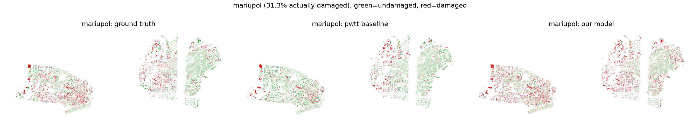
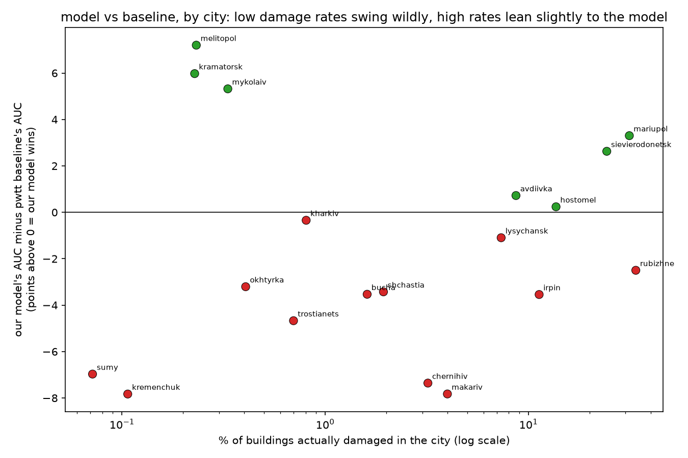

# ukraine building damage assessment

detects war damage to buildings in ukraine from free satellite radar data, trains a model, and compares it honestly against a published baseline.

**full writeup with interactive maps**: [live pages site](https://vinechai.github.io/ukraine-building-damage-assessment/)

## what it does

- downloads a real, published benchmark ([pwtt](https://github.com/oballinger/PWTT)): 873k buildings across 19 ukrainian cities with real un damage assessments
- pulls raw sentinel-1 radar time series ourselves via google earth engine, not just the paper's precomputed numbers
- trains a model and compares it against the paper's own baseline with proper leave-one-city-out cross validation
- extends the model to present day prediction, honestly reporting two real bugs found and fixed, and one left open

## result



across 19 cities, the simple published baseline beats our trained model on average (mean AUC 73.8 vs 72.4), matching what the original paper already found. independent confirmation of a published result, not a failed experiment.



our model wins outright on 7 of 19 cities. the pattern is more about sample size than damage severity: cities with very few actually damaged buildings swing wildly in both directions, which is noise, not a real effect (checked with a permutation test). full breakdown and the present day extension (with two real bugs found and fixed) are in the [writeup](https://vinechai.github.io/ukraine-building-damage-assessment/).

## why not computer vision

a building is roughly the size of one satellite pixel at this resolution, so there is no image for a cnn to look at. this is a small, hand built set of geospatial time series features fed into plain scikit-learn classifiers (logistic regression, random forest, gradient boosting).

## running it

```
pip install -r requirements.txt
python scripts/download_benchmark.py
python scripts/explore_benchmark.py --cities mariupol bucha irpin --plot
```

everything past that needs a free google earth engine account. run `earthengine authenticate` once, then:

```
python scripts/pull_all_sentinel1.py --project <your-gee-project-id>
python scripts/build_training_table.py
python scripts/cross_validate_cities.py
```

## structure

```
scripts/download_benchmark.py       downloads the real pwtt benchmark data
scripts/explore_benchmark.py        inspect the data, draw a damage map
scripts/pull_all_sentinel1.py       pulls raw sentinel-1 radar data for all 19 cities
scripts/build_training_table.py     turns raw radar data into one row per building
scripts/cross_validate_cities.py    the real evaluation, leave one city out
scripts/predict_current_snapshot.py applies the trained model to present day data
src/data/                           loaders and feature engineering
docs/                                the pages site, interactive maps included
```
